# AI Doodle Studio — Software Architecture Document

**Document Version:** 1.0.0  
**Status:** Approved / Architecture Baseline  
**Target Systems:** macOS (Primary), Linux, Windows  
**Author:** AI Doodle Studio Engineering Team  

---

## 1. Executive Summary & System Purpose

**AI Doodle Studio** is a professional-grade, lightweight 2D frame-by-frame animation desktop application designed for illustrators, animators, and digital artists. Built upon Python 3.11+ and the PySide6 (Qt 6) framework, the application emphasizes responsive freehand drawing, intuitive timeline-based sequencing, real-time onion skinning, and seamless video import/export workflows.

The system decouples the core animation data structures from the presentation layer, leveraging hardware-accelerated 2D graphics rendering via Qt's `QPainter`, an asynchronous worker thread pool for compute-heavy media operations, and an extensible undo/redo architecture based on the Command pattern.

```
┌─────────────────────────────────────────────────────────────────────────────┐
│                             AI DOODLE STUDIO                                │
│                   Professional 2D Animation Workstation                     │
└─────────────────────────────────────┬───────────────────────────────────────┘
                                      │
            ┌─────────────────────────┼─────────────────────────┐
            ▼                         ▼                         ▼
   ┌─────────────────┐       ┌─────────────────┐       ┌─────────────────┐
   │ Drawing Engine  │       │ Animation Core  │       │ Media Pipeline  │
   │ Smooth strokes, │       │ Frame sequence, │       │ Video import,   │
   │ tools, brushes  │       │ onion skinning  │       │ MP4/GIF export  │
   └─────────────────┘       └─────────────────┘       └─────────────────┘
```

---

## 2. Technology Stack & Dependencies

The application leverages a curated set of robust, cross-platform technologies focused on high performance, stability, and zero runtime bloat.

### 2.1 Technology Matrix

| Component | Technology | Minimum Version | Category | Purpose / Rationale |
| :--- | :--- | :--- | :--- | :--- |
| **Language Runtime** | Python | `>= 3.11` | Core | Modern language features, performance improvements, typing enhancements. |
| **UI Framework** | PySide6 (Qt 6) | `>= 6.6.0` | Core GUI | Native cross-platform desktop widgets, high-DPI scaling, event system. |
| **2D Drawing Engine** | `QPainter` / `QImage` | Qt 6 Built-in | Rendering | High-performance raster canvas manipulation with sub-pixel anti-aliasing. |
| **Numerical Processing**| NumPy | `>= 1.26.0` | Optional / Fast Math | Fast vectorized array manipulation for raster compositing and brush masks. |
| **Video Decoding** | OpenCV (`cv2`) | `>= 4.8.0` | Optional / Media | Frame-accurate video extraction for rotoscoping and background reference. |
| **Video Encoding** | FFmpeg (CLI) | `>= 5.0` | Subprocess | Industry-standard H.264/H.265/ProRes video export and MP4 multiplexing. |
| **Raster Fallback** | Pillow (PIL) | `>= 10.0.0` | Optional / Media | Animated GIF generation fallback and extended image format conversions. |
| **Project Storage** | `zipfile` + `json` + `png`| Python Standard Lib | Storage | Open, resilient, cross-platform compressed native document format (`.adsproj`). |

### 2.2 Dependency Philosophy
- **Zero Heavy Native C++ Compilations at Install Time:** The application relies on official pre-built PySide6 and standard wheels.
- **Graceful Degradation:** Features requiring optional external libraries (such as FFmpeg for MP4 export or OpenCV for video import) degrade gracefully with informative UI alerts and fallbacks rather than crashing the application.

---

## 3. Architectural Principles & Design Patterns

The architecture is governed by five foundational design principles:

1. **Strict 3-Tier Layer Separation:** Clear boundaries between UI widgets, drawing operations, and the document core.
2. **Headless Core Principle:** The core domain model (`app/core/`) possesses zero dependencies on Qt GUI widgets (`QWidget`, `QMainWindow`, etc.). It deals purely with animation states, metadata, and memory buffers (`QImage`). This guarantees scriptability, automated testability without a display server, and headless batch export capability.
3. **Command Pattern (Undo/Redo):** Every mutating canvas and timeline action is encapsulated within an atomic command object with bi-directional execution logic (`redo()` and `undo()`).
4. **Reactive Qt Signal/Slot Communication:** Loose coupling between independent components. Emitters have no knowledge of receivers.
5. **Double-Buffered Non-Destructive Canvas:** Active drawing strokes are previewed on a transient overlay buffer and merged onto the target frame's bitmap only upon mouse release.

---

## 4. System Layer Architecture

AI Doodle Studio is organized into three primary architectural tiers plus orthogonal media and theming utilities:

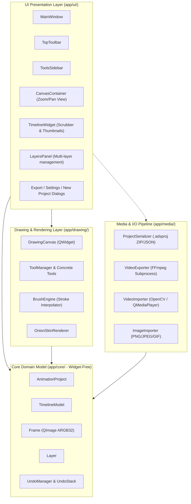

### 4.1 Tier Responsibilities

#### Tier 1: UI Presentation Layer (`app/ui/`)
- Manages window lifecycle, menu bars, toolbars, docking panels, and dialogs.
- Translates raw user intentions (key presses, button clicks, slider adjustments) into high-level domain commands.
- Hosts viewport widgets (`CanvasContainer`) equipped with hardware-accelerated smooth panning and zooming via transformation matrices.

#### Tier 2: Drawing & Rendering Layer (`app/drawing/`)
- Handles low-latency mouse and tablet pen input events.
- Employs Catmull-Rom spline interpolation and distance-based smoothing in `BrushEngine` to eliminate jagged lines.
- Computes dirty bounding rects to minimize canvas repaints.
- Renders onion skins by compositing adjacent frame buffers with alpha tinting.

#### Tier 3: Core Domain Model (`app/core/`)
- Maintains the document graph: `AnimationProject` contains metadata and a `TimelineModel`; `TimelineModel` manages an ordered collection of `Frame` objects.
- Each `Frame` manages one or more raster pixel buffers (`QImage` formatted as `Format_ARGB32_Premultiplied`).
- Houses the `UndoManager`, which maintains an undo/redo stack bounded by configurable memory limits.

#### Cross-Cutting: Media Pipeline (`app/media/`)
- Manages serialized persistence to disk in the native `.adsproj` archive format.
- Interfaces with external command-line binaries (FFmpeg) and decoders via background threads (`QThread`).

---

## 5. Project Directory & Module Breakdown

The project follows a clean, modular structure where every module has a single, well-defined purpose:

```
ai_doodle_studio/
├── main.py                     # Entry point: QApplication setup, splash screen, theme loading
├── requirements.txt            # Python dependencies (PySide6, numpy, opencv, pillow)
├── README.md                   # Project overview, installation, and usage instructions
├── docs/                       # Architectural & design documentation
│   ├── apk_analysis.md         # Reference analysis of mobile animation apps (FlipaClip)
│   ├── desktop_feature_spec.md # Complete desktop feature specification
│   └── architecture.md         # This architecture specification document
├── app/
│   ├── __init__.py
│   ├── core/                   # Pure document model (UI-independent)
│   │   ├── __init__.py
│   │   ├── project.py          # AnimationProject: Document root, dimensions, FPS, metadata
│   │   ├── frame.py            # Frame: Raster bitmap container, layer stack, dirty flags
│   │   ├── layer.py            # Layer: Independent drawing layer with opacity and blend mode
│   │   ├── timeline.py         # TimelineModel: Frame indexing, ordering, insertion, deletion
│   │   └── history.py          # UndoManager: Command pattern, memory-capped undo stack
│   ├── drawing/                # Interactive drawing engine
│   │   ├── __init__.py
│   │   ├── canvas.py           # DrawingCanvas: QWidget intercepting mouse/tablet events
│   │   ├── tools.py            # Tool base class and implementations (Pen, Eraser, Fill, Shape)
│   │   └── brush_engine.py     # BrushEngine: Catmull-Rom point interpolation and dab spacing
│   ├── animation/              # Playback and compositing engine
│   │   ├── __init__.py
│   │   ├── playback.py         # PlaybackController: High-precision frame timing & looping
│   │   └── onion_skin.py       # OnionSkinRenderer: Multi-frame ghosting and color-tint compositing
│   ├── media/                  # Media serialization & I/O
│   │   ├── __init__.py
│   │   ├── project_io.py       # Native .adsproj ZIP/JSON serializer & deserializer
│   │   ├── image_import.py     # Image importer for backgrounds and frame sequences
│   │   ├── video_import.py     # Video importer extracting frames via OpenCV
│   │   └── video_export.py     # Background worker invoking FFmpeg for MP4/GIF export
│   ├── ui/                     # PySide6 Qt GUI presentation components
│   │   ├── __init__.py
│   │   ├── main_window.py      # MainWindow: Main window scaffolding, layout, action wiring
│   │   ├── toolbar.py          # TopToolbar: Project operations, undo/redo, playback triggers
│   │   ├── tools_sidebar.py    # ToolsSidebar: Tool selection, brush size, color swatch picker
│   │   ├── canvas_view.py      # CanvasContainer: QScrollArea / QGraphicsView with zoom & pan
│   │   ├── timeline_view.py    # TimelineWidget: Visual frame strip, scrubbing, thumbnail cards
│   │   ├── layers_panel.py     # LayersPanel: Layer visibility, opacity, order controls
│   │   └── dialogs.py          # ExportDialog, ProjectSettingsDialog, NewProjectDialog
│   └── theme/                  # Styling & aesthetics
│       ├── __init__.py
│       └── styles.py           # Modern dark-theme QSS stylesheet and icon palette
└── tests/                      # Automated test suite
    ├── __init__.py
    ├── test_core.py            # Unit tests for Frame, TimelineModel, UndoManager
    ├── test_project_io.py      # Unit tests for project save/load roundtripping
    └── test_drawing.py         # Tests for BrushEngine interpolation and raster tools
```

---

## 6. Core Data Models & Domain Logic

The data model is strictly hierarchical. An `AnimationProject` owns project-wide attributes and a single `TimelineModel`. The `TimelineModel` maintains an ordered sequence of `Frame` instances. Each `Frame` contains one or more `Layer` instances containing a `QImage` raster buffer.

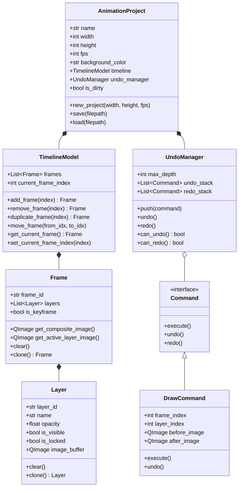

### 6.1 `Frame` and `Layer` Specifications
- **Pixel Format:** All raster buffers are allocated as `QImage::Format_ARGB32_Premultiplied`. Premultiplied alpha is essential for high-performance blitting and anti-aliased alpha blending during active drawing strokes.
- **Canvas Resolution:** Defaults to standard 1080p (1920×1080), with presets for 720p (1280×720), Square (1080×1080), and Social Media Vertical 9:16 (1080×1920).
- **Composite Image Generation:** When multiple layers are present, `Frame.get_composite_image()` merges visible layers from bottom to top using `QPainter::CompositionMode_SourceOver`.

---

## 7. Drawing & Rendering Engine Architecture

The drawing subsystem bridges raw OS hardware events and pixel-level frame manipulation.

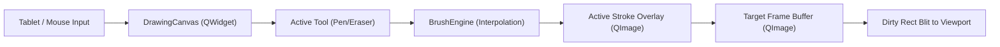

### 7.1 Coordinate Transformations
Three distinct coordinate spaces operate simultaneously within the canvas:
1. **Screen / Viewport Space:** Physical pixels on the screen (subject to OS DPI scaling).
2. **Widget Space:** Local coordinates within `DrawingCanvas` (scaled by current zoom factor $Z$ and translated by pan offsets $T_x, T_y$).
3. **Canvas / Frame Space:** The true pixel space of the animation frame (e.g., $1920 \times 1080$).

The mapping from Widget coordinates $(x_w, y_w)$ to Frame coordinates $(x_f, y_f)$ is defined by the affine transformation:
$$x_f = \frac{x_w - T_x}{Z}, \quad y_f = \frac{y_w - T_y}{Z}$$

### 7.2 Brush Smoothing and Point Interpolation
Freehand input from mice and digitizer tablets arrives as discrete, non-uniform point packets. Direct linear connection produces angular, jagged strokes. The `BrushEngine` resolves this via:
- **Catmull-Rom Spline Interpolation:** For any four consecutive points $P_0, P_1, P_2, P_3$, smooth intermediate curves are generated between $P_1$ and $P_2$.
- **Distance-Based Dab Spacing:** Circular or custom brush dabs are stamped at equal arc-length increments (e.g., spacing = $25\%$ of brush diameter), preventing density variations when moving the cursor quickly.
- **Pressure Sensitivity:** When tablet stylus events (`QTabletEvent`) are detected, pressure values $[0.0, 1.0]$ dynamically modulate the brush radius and opacity.

### 7.3 Non-Destructive Stroke Buffering
During mouse/stylus drag:
1. The original frame buffer remains untouched.
2. The active stroke is rendered onto a dedicated `temp_stroke_layer` (`QImage`).
3. The viewport repaints only the bounding rectangle of the latest stroke segment.
4. On `mouseReleaseEvent`, the stroke buffer is composited onto the active frame's layer via `QPainter`, the `DrawCommand` is pushed to `UndoManager`, and the temp buffer is cleared.

### 7.4 Onion Skinning Pipeline
The `OnionSkinRenderer` allows animators to see preceding and succeeding frames with configurable tinting and opacity:
- **Past Frames:** Rendered with a red/orange tint and a default falloff opacity (e.g., $30\%$ for frame $N-1$, $15\%$ for frame $N-2$).
- **Future Frames:** Rendered with a blue/green tint and a default falloff opacity (e.g., $30\%$ for frame $N+1$, $15\%$ for frame $N+2$).
- **Color Tinting Mechanism:** Executed using `QPainter::CompositionMode_SourceIn` on a cloned alpha mask, or direct shader/pixel math, ensuring zero destruction to stored frames.

---

## 8. Animation & Playback Engine

The animation engine orchestrates real-time frame sequencing and transport control.

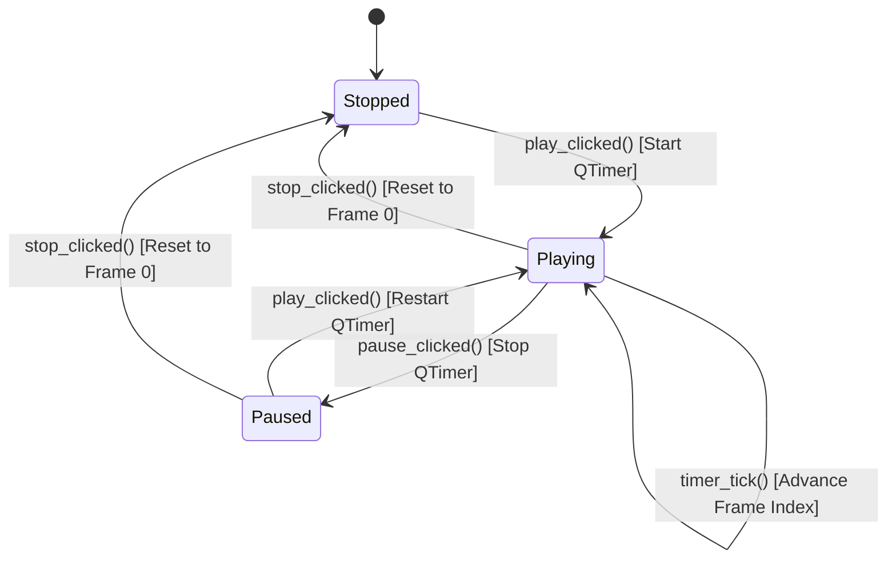

### 8.1 Playback Controller Mechanics
- **Timer Mechanism:** Uses a high-precision `QTimer` configured with `Qt::PreciseTimer` running at an interval of:
  $$\Delta t = \frac{1000}{\text{fps}} \text{ ms}$$
  For example, 12 FPS yields an 83.33 ms interval; 24 FPS yields a 41.66 ms interval.
- **Decoupled Playback View:** During playback, tool interaction, onion skinning, and hover indicators are disabled to guarantee maximum frame rendering throughput.
- **Loop Modes:** Supports **Loop** (continuous cycling), **Ping-Pong** (forward then reverse), and **Once** (stop at final frame).

---

## 9. Key Workflows & Data Flows

### 9.1 Drawing Workflow (Stroke Lifecycle)
This sequence traces the path from hardware mouse down to undo stack registration.

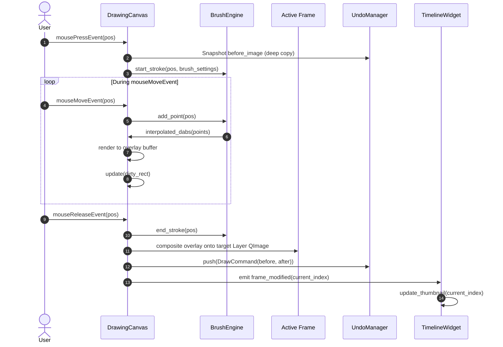

### 9.2 Frame Navigation Workflow
When the animator selects a frame in the timeline or uses keyboard shortcuts (Left/Right arrows):

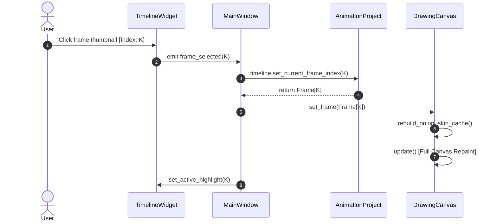

### 9.3 Undo / Redo Execution Workflow
Reverting a drawn stroke without dropping frames or desynchronizing thumbnails:

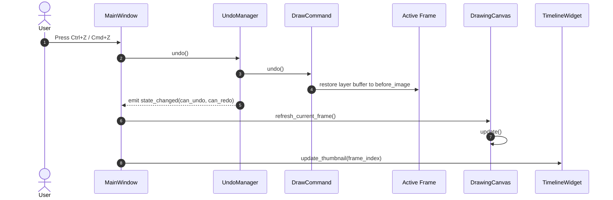

### 9.4 Playback Loop Workflow
Real-time playback loop driven by `QTimer`:

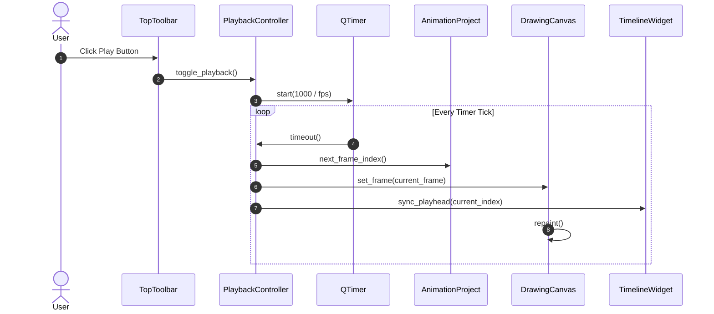

### 9.5 Project Save & Load Pipeline
The native `.adsproj` file persistence lifecycle:

```mermaid
flowchart TD
    subgraph Save_Pipeline["Save Project (.adsproj)"]
        S1["User triggers Save (Ctrl+S)"] --> S2["Serialize AnimationProject metadata to project.json"]
        S2 --> S3["Create temporary ZIP container in memory/scratch"]
        S3 --> S4["Write project.json to archive root"]
        S4 --> S5["Iterate each Frame: save layers/frames as frame_NNNN.png"]
        S5 --> S6["Generate 120x90 thumbnails: save as thumb_NNNN.png"]
        S6 --> S7["Atomic write/replace target .adsproj file on disk"]
        S7 --> S8["Reset Project.is_dirty = False"]
    end

    subgraph Load_Pipeline["Load Project (.adsproj)"]
        L1["User selects .adsproj file"] --> L2["Extract ZIP archive in memory / temp stream"]
        L2 --> L3["Parse project.json: validate version, resolution, FPS"]
        L3 --> L4["Instantiate AnimationProject and TimelineModel"]
        L4 --> L5["Read frames/frame_NNNN.png into QImage buffers"]
        L5 --> L6["Populate Frame objects and regenerate thumbnails"]
        L6 --> L7["Set current frame to 0 & update Canvas / Timeline UI"]
    end
```

### 9.6 Video and GIF Export Pipeline
Exporting the animation to standard video formats without blocking the UI:

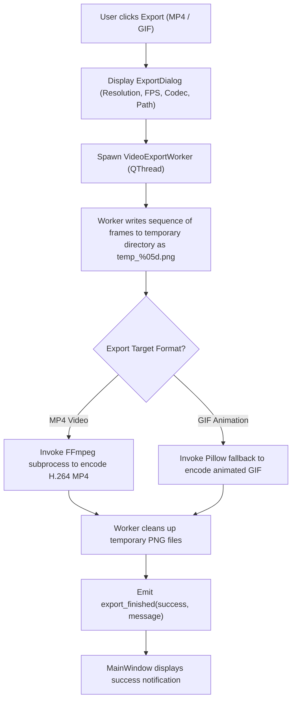

---

## 10. Signal & Slot Connection Topology

Qt's signal/slot mechanism guarantees full decoupling between user interface widgets and the underlying application state.

### 10.1 Inter-Component Wiring Graph

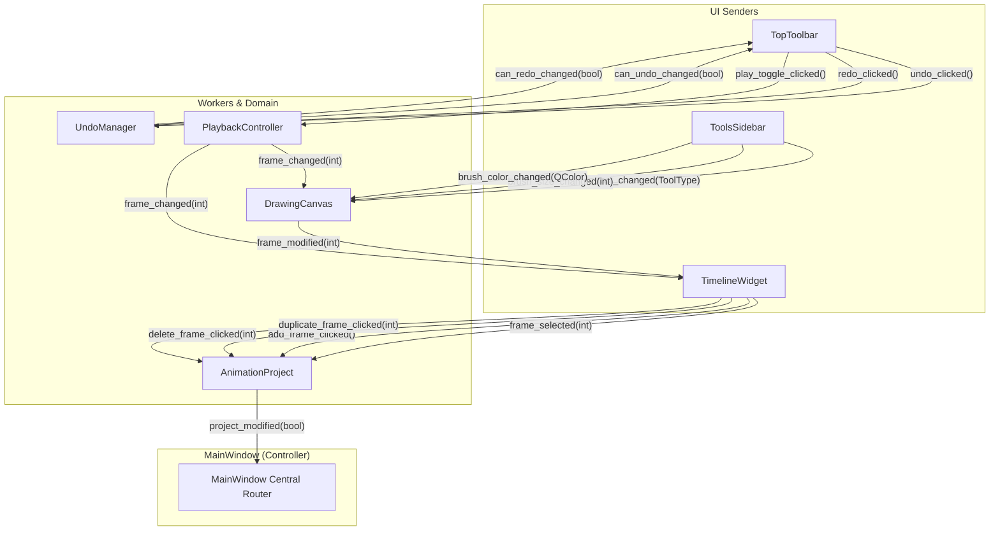

### 10.2 Comprehensive Signal-Slot Connection Matrix

| Source Emitter | Signal | Destination Receiver | Slot / Handler Method | Purpose |
| :--- | :--- | :--- | :--- | :--- |
| `ToolsSidebar` | `tool_changed(ToolType)` | `DrawingCanvas` | `set_tool(ToolType)` | Switches active drawing tool (Pen, Eraser, Fill). |
| `ToolsSidebar` | `brush_size_changed(int)` | `DrawingCanvas` | `set_brush_size(int)` | Updates stroke dab radius. |
| `ToolsSidebar` | `color_changed(QColor)` | `DrawingCanvas` | `set_brush_color(QColor)` | Updates active drawing brush color. |
| `TimelineWidget`| `frame_selected(int)` | `MainWindow` | `on_frame_selected(int)` | Switches the active frame in project and canvas. |
| `TimelineWidget`| `add_frame_clicked()` | `MainWindow` | `on_add_frame()` | Inserts a new blank frame after current frame. |
| `TimelineWidget`| `delete_frame_clicked(int)`| `MainWindow` | `on_delete_frame(int)` | Removes the specified frame from project. |
| `TopToolbar` | `play_clicked()` | `PlaybackController` | `toggle_playback()` | Starts or stops animation playback. |
| `TopToolbar` | `undo_clicked()` | `UndoManager` | `undo()` | Reverts the most recent user action. |
| `TopToolbar` | `redo_clicked()` | `UndoManager` | `redo()` | Re-applies the next command in history. |
| `DrawingCanvas` | `frame_modified(int)` | `TimelineWidget` | `update_thumbnail(int)` | Requests immediate re-render of frame thumbnail. |
| `DrawingCanvas` | `stroke_finished(Command)`| `UndoManager` | `push(Command)` | Registers new atomic command on undo stack. |
| `PlaybackController`| `frame_changed(int)`| `DrawingCanvas` | `set_frame_index(int)` | Updates canvas to display new playback frame. |
| `PlaybackController`| `frame_changed(int)`| `TimelineWidget` | `highlight_frame(int)` | Moves timeline playhead indicator in sync. |
| `UndoManager` | `state_changed(bool, bool)`| `TopToolbar` | `update_undo_state(bool, bool)` | Enables/disables Undo and Redo UI buttons. |
| `AnimationProject`| `project_changed(bool)`| `MainWindow` | `update_window_title(bool)` | Updates dirty asterisk (`*`) on window title. |

---

## 11. Project File Format (`.adsproj`)

The native document format for AI Doodle Studio is `.adsproj`. It is structured as an unencrypted, standardized ZIP archive containing human-readable JSON metadata alongside standard PNG image assets.

### 11.1 ZIP Archive Structure
```
project_name.adsproj (Standard PKZIP Archive)
├── project.json                # Project-level configuration and metadata
├── frames/                     # High-resolution frame raster bitmaps
│   ├── frame_0000.png          # Frame 0 layer raster (ARGB32)
│   ├── frame_0001.png          # Frame 1 layer raster (ARGB32)
│   ├── frame_0002.png          # Frame 2 layer raster (ARGB32)
│   └── ...
└── thumbnails/                 # Pre-rendered 120x90 cache for fast project opening
    ├── thumb_0000.png
    ├── thumb_0001.png
    └── ...
```

### 11.2 `project.json` Schema Specification
```json
{
  "$schema": "https://json-schema.org/draft/2020-12/schema",
  "title": "AIDoodleStudioProject",
  "version": 1,
  "generator": "AI Doodle Studio v1.0.0",
  "created_at": "2026-10-16T14:30:00Z",
  "modified_at": "2026-10-16T15:45:22Z",
  "metadata": {
    "name": "Walk Cycle Study",
    "author": "Vipin Kumar",
    "description": "Character walk cycle animation test"
  },
  "settings": {
    "canvas_width": 1920,
    "canvas_height": 1080,
    "fps": 12,
    "background_type": "solid",
    "background_color": "#FFFFFF"
  },
  "onion_skin_settings": {
    "enabled": true,
    "frames_before": 2,
    "frames_after": 1,
    "opacity_falloff": 0.5,
    "tint_past": "#FF3B30",
    "tint_future": "#34C759"
  },
  "timeline": {
    "total_frames": 24,
    "frame_order": [
      "frame_0000",
      "frame_0001",
      "frame_0002"
    ],
    "layers": [
      {
        "layer_id": "layer_0",
        "name": "Line Art",
        "visible": true,
        "opacity": 1.0,
        "blend_mode": "Normal"
      }
    ]
  }
}
```

### 11.3 Versioning & Migration Strategy
- `project.json` stores an integer `version` field.
- When opening older projects, an internal `ProjectMigrator` sequentially applies incremental schema migrations (e.g., `migrate_v1_to_v2()`).
- Atomic save mechanism: Writing writes to a temporary file (`project_name.adsproj.tmp`) before atomic renaming (`os.replace`) to prevent file corruption during OS crashes or disk full conditions.

---

## 12. Concurrency & Threading Model

To ensure a continuous 60 FPS UI experience free of cursor stutter or dropped frames, AI Doodle Studio employs a strict multi-threading model using Qt's `QThread` and asynchronous workers.

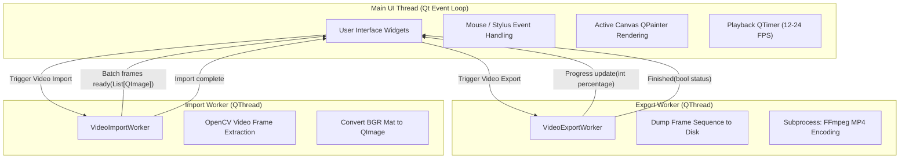

### 12.1 Thread Safety Guidelines
1. **QImage Isolation:** `QImage` is re-entrant but not thread-safe. Once a `QImage` is passed to a background worker for serialization or video encoding, the main thread operates exclusively on deep copies or locks the frame until the worker clones it.
2. **Subprocess Management:** External binaries (FFmpeg) are invoked via Python's `subprocess.Popen` inside a `QThread`, capturing `stdout` and `stderr` asynchronously to report percentage completion back to the `ExportDialog` progress bar without blocking GUI responsiveness.

---

## 13. Memory Management & Performance Optimization

2D animation software can quickly consume vast amounts of RAM if uncompressed bitmaps are retained unchecked in memory.

### 13.1 Memory Footprint Analysis

| Resolution | Single Frame (`ARGB32`) | 50 Frames | 100 Frames | 250 Frames |
| :--- | :--- | :--- | :--- | :--- |
| **720p (1280×720)** | 3.68 MB | 184 MB | 368 MB | 920 MB |
| **1080p (1920×1080)** | 8.29 MB | 414 MB | 829 MB | 2.07 GB |
| **4K UHD (3840×2160)** | 33.17 MB | 1.65 GB | 3.31 GB | 8.29 GB |

### 13.2 Memory Optimization Strategies

```
┌────────────────────────────────────────────────────────────────────────┐
│                        MEMORY SAFEGUARDS                               │
├────────────────────────────────┬───────────────────────────────────────┤
│ Undo Stack Depth Limit         │ Bounded to 50 commands.               │
│                                │ Drops oldest snapshots via FIFO.      │
├────────────────────────────────┼───────────────────────────────────────┤
│ Bounding-Rect Delta Undo       │ Undo commands store only the dirty    │
│                                │ bounding box cropped sub-image        │
│                                │ instead of full 1080p frame copies.   │
├────────────────────────────────┼───────────────────────────────────────┤
│ Thumbnail Cache (120x90)       │ Timeline stores lightweight 43 KB     │
│                                │ QPixmaps instead of full QImages.     │
├────────────────────────────────┼───────────────────────────────────────┤
│ Lazy Loading for Large Files   │ Projects exceeding 200 frames load    │
│                                │ frame buffers on-demand from disk.    │
└────────────────────────────────┴───────────────────────────────────────┘
```

- **Dirty Region Sub-Image Snapshots:** Instead of copying the entire $1920 \times 1080$ frame ($8.3 \text{ MB}$) for a tiny pen mark, the `DrawCommand` calculates the minimal bounding rectangle enclosing the stroke (e.g., $150 \times 150 \approx 90 \text{ KB}$), achieving a **98% memory reduction** on undo states.
- **Explicit Garbage Collection:** When deleting frames, pixel buffers are explicitly re-initialized, freeing unreferenced image memory back to the OS.

---

## 14. Error Handling & Fault Resilience

The system guarantees that unexpected failures in auxiliary tools or corrupt inputs never cause data loss or application crashes.

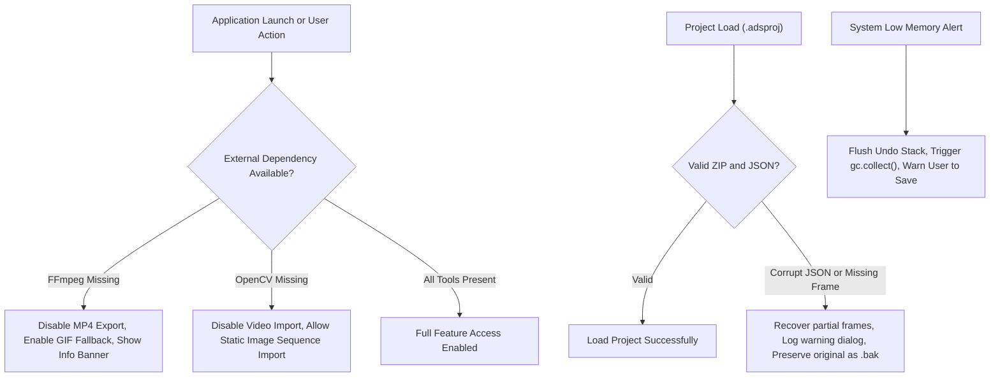

### 14.1 Diagnostic and Recovery Procedures
- **Missing FFmpeg:** On startup, `shutil.which("ffmpeg")` checks for binary availability. If absent, MP4 export options are disabled with a non-intrusive tooltip directing the user to install FFmpeg (via Homebrew on macOS, package manager on Linux).
- **Corrupt Archive Recovery:** If a `.adsproj` archive suffers partial corruption, the loader parses all readable PNG frames, constructs a valid project containing the recovered frames, and prompts the user to save to a new file.
- **Crash Prevention via Atomic Writes:** Projects are never directly overwritten in place. Instead, new data is written to a temporary sibling file and replaced atomically.

---

## 15. Cross-Platform Compatibility

| Platform | Primary Considerations & Solutions |
| :--- | :--- |
| **macOS (Primary)** | Native Retina display support via `Qt::AA_EnableHighDpiScaling` and `Qt::AA_UseHighDpiPixmaps`. Standard macOS keyboard shortcuts (`Cmd+Z`, `Cmd+S`, `Cmd+Q`). Native Unified Title Bar support. |
| **Linux (X11 / Wayland)** | Compatible with both Wayland and X11 display servers. Styled cleanly via QSS dark stylesheet without relying on OS-specific desktop environment themes. |
| **Windows 10 / 11** | Cross-platform path handling using Python `pathlib.Path`. Subprocess commands use `shell=False` with argument lists to eliminate shell injection vulnerabilities. |

---

## 16. Future Extensibility & Technical Roadmap

The architecture anticipates future enhancements through modular extension points:

1. **Plugin Architecture for Custom Brushes:**
   - Abstract plugin interface (`BrushPluginInterface`) allowing third-party Python modules to register custom procedural brush tips, dynamics, and textures without modifying core code.
2. **Advanced Layer Compositing & Blend Modes:**
   - Extend `Frame` to support arbitrary layer hierarchies with standard Photoshop-style blend modes (Multiply, Screen, Overlay, Color Dodge).
   - Add Bézier vector stroke storage alongside raster pixel caching.
3. **AI Integration Points (Frame Generation & In-Betweening):**
   - Headless background worker interface in `app/animation/` for neural optical flow or frame interpolation models (e.g., RIFE, FILM) to generate in-between frames between hand-drawn keyframes.
   - Text-to-doodle style transfer and sketch cleanup hooks.
4. **Krita Bridge & External Interchange:**
   - Bidirectional export/import to standard OpenRaster (`.ora`) and Adobe Photoshop (`.psd`) formats for seamless round-tripping with professional desktop illustration suites.
5. **Network Collaboration & Remote Co-Drawing:**
   - WebRTC / WebSocket event stream adapter to broadcast atomic `DrawCommand` payloads between remote artists sharing an animation timeline session.
6. **Audio Scrubbing & Multi-Track Audio:**
   - Dedicated low-latency audio engine using `QAudioSink` / `miniaudio` allowing animators to scrub waveforms and synchronize character mouth shapes with dialogue tracks directly on the timeline.

---

*AI Doodle Studio Architecture Specification — Version 1.0.0*
